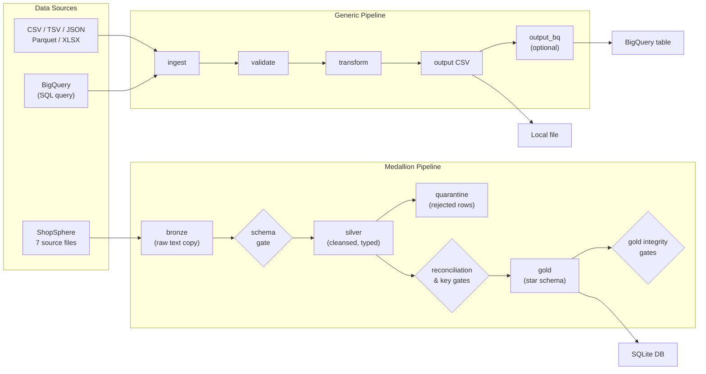
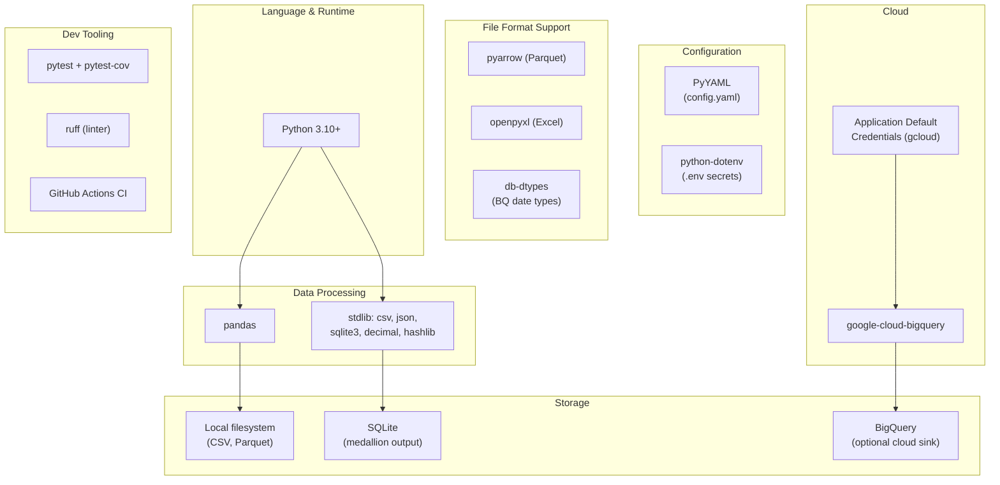
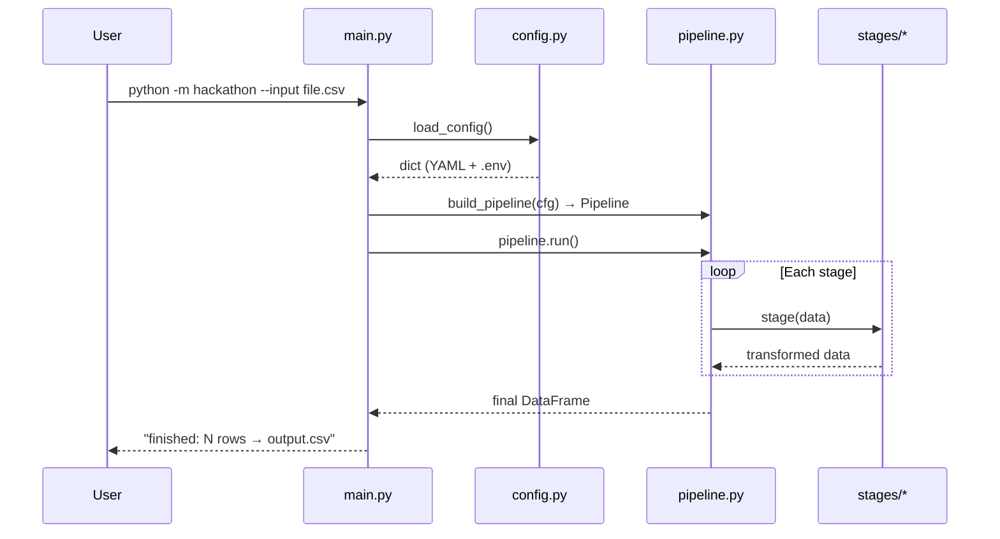
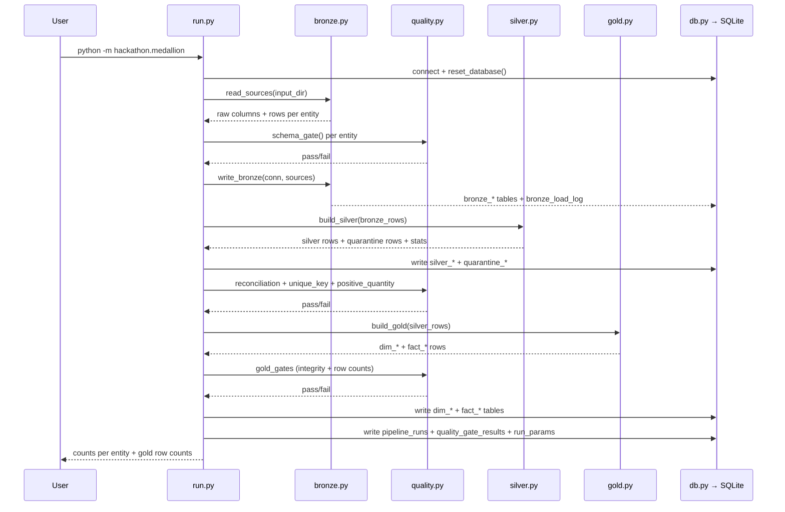
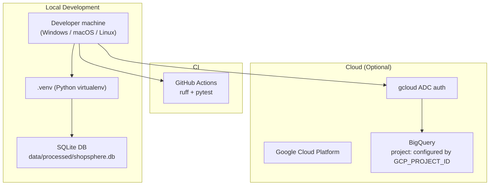

# Architecture

> Overall system architecture for the HCL Hackathon Starter — ShopSphere e-commerce analytics platform.

---

## System overview

The project contains **two independent pipelines** that share configuration and utility code:

| Pipeline | Entry point | Purpose |
|----------|-------------|---------|
| **Generic pipeline** | `python -m hackathon --input <file>` | Config-driven ingest → validate → transform → output for any tabular file, with optional BigQuery source/sink |
| **Medallion pipeline** | `python -m hackathon.medallion` | ShopSphere e-commerce data: raw files → bronze → silver (+ quarantine) → quality gates → gold star schema in SQLite |



---

## Repository layout

```
hcl-hackathon-starter/
├── config/
│   └── config.yaml              # Central settings for both pipelines
├── data/
│   ├── raw/                     # Source files (git-ignored contents)
│   │   └── Ecommerce_Analytics_SourceData/
│   │       └── Ecommerce_Analytics_SourceData/
│   │           ├── customers.csv
│   │           ├── orders.csv
│   │           ├── order_items.csv
│   │           ├── payments.csv
│   │           ├── products.csv
│   │           ├── returns.csv
│   │           └── suppliers.json
│   ├── interim/                 # Scratch / intermediate data
│   └── processed/               # Pipeline outputs (CSV, SQLite DB)
├── docs/
│   ├── architecture.md          # ← this file
│   ├── design.md                # Design decisions and patterns
│   ├── data_model.md            # Gold star schema reference
│   └── DECISIONS.md             # Numbered decision log
├── reports/
│   └── profiling_report.md      # Source data profiling results
├── reports/kpi_outputs/         # Generated KPI CSVs and manifest
├── notebooks/                   # Exploration notebooks
├── src/hackathon/
│   ├── config.py                # YAML + .env loader
│   ├── logging_setup.py         # Logging configuration
│   ├── pipeline.py              # Generic stage runner
│   ├── main.py                  # Generic pipeline CLI
│   ├── stages/                  # Generic pipeline stages
│   │   ├── ingest.py
│   │   ├── validate.py
│   │   ├── transform.py
│   │   ├── output.py
│   │   └── bigquery.py
│   └── medallion/               # ShopSphere medallion pipeline
│       ├── run.py               # Orchestrator + CLI
│       ├── bronze.py            # Raw ingestion layer
│       ├── silver.py            # Cleansing + dedup layer
│       ├── gold.py              # Star schema builder
│       ├── quality.py           # Quality gates
│       ├── common.py            # Shared cleaning helpers
│       └── db.py                # SQLite abstraction
├── tests/                       # pytest suite
├── .github/workflows/ci.yml     # Ruff + pytest on push/PR
├── pyproject.toml               # Dependencies and tooling
├── .env.example                 # Secret template (GCP_PROJECT_ID, LOG_LEVEL)
└── README.md                    # Quick start
```

---

## Technology stack



| Layer | Technology | Why |
|-------|-----------|-----|
| Language | Python 3.10+ | Data engineering standard; every cloud SDK supports it |
| Generic data processing | pandas | Fast prototyping; unified API for CSV/JSON/Parquet/Excel |
| Medallion data processing | Python stdlib (`csv`, `json`, `sqlite3`, `decimal`) | Zero extra dependencies; full control over cleaning logic |
| Local storage | CSV files, SQLite | No infrastructure needed; SQLite gives relational queries out of the box |
| Cloud storage | BigQuery via `google-cloud-bigquery` | Official SDK, ADC auth, cost guard with `max_bytes_billed` |
| Configuration | PyYAML + python-dotenv | Human-readable config with comments; secrets stay out of git |
| CI | GitHub Actions + ruff + pytest | Free, fast, catches broken commits before merge |

---

## Data flow — Generic pipeline



**Stages in order:** `ingest` → `validate` → `transform` → `output` → `output_bq` (optional)

---

## Data flow — Medallion pipeline



**Gate enforcement:** if any gate fails, the pipeline stops immediately and gold tables are **not** written. Failed runs are logged in `pipeline_runs` with status `FAILED`.

---

## Deployment topology



Currently the project runs locally with SQLite output. BigQuery is available as an optional cloud source/sink via the generic pipeline. No Docker, Airflow, or cloud orchestration is included yet — by design, to keep the hackathon setup lightweight.
