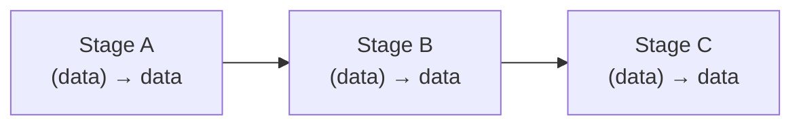
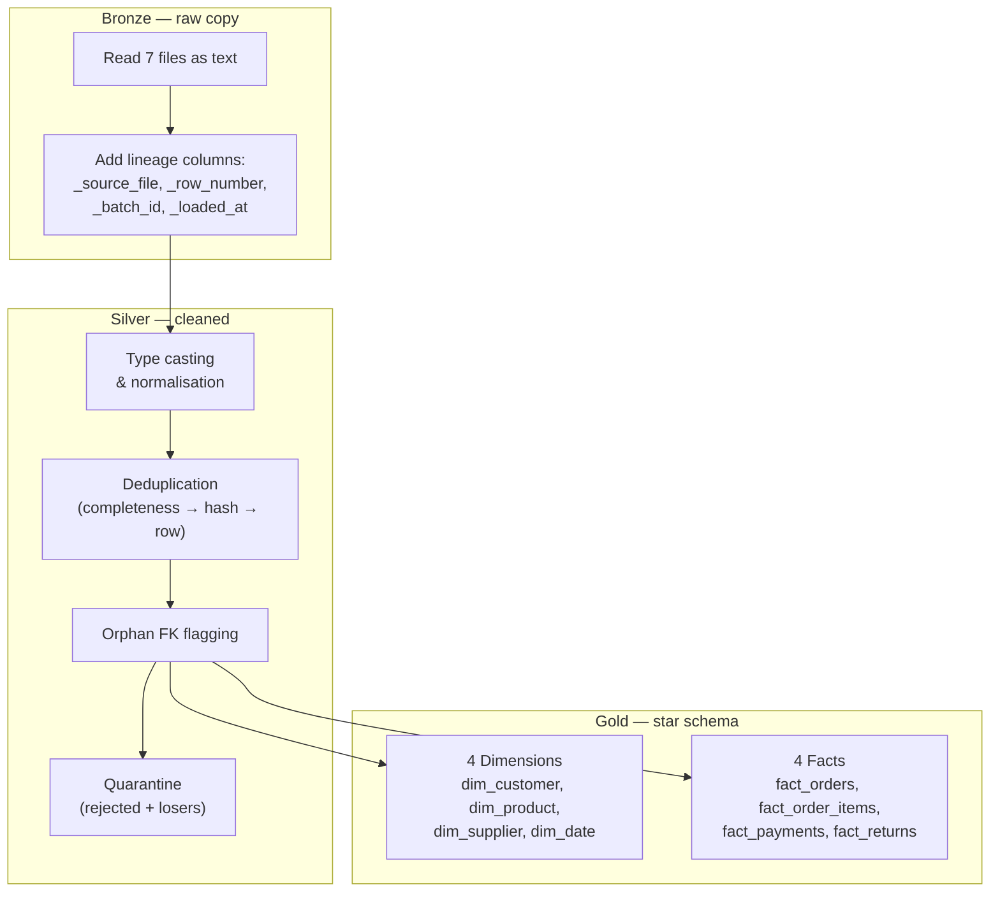
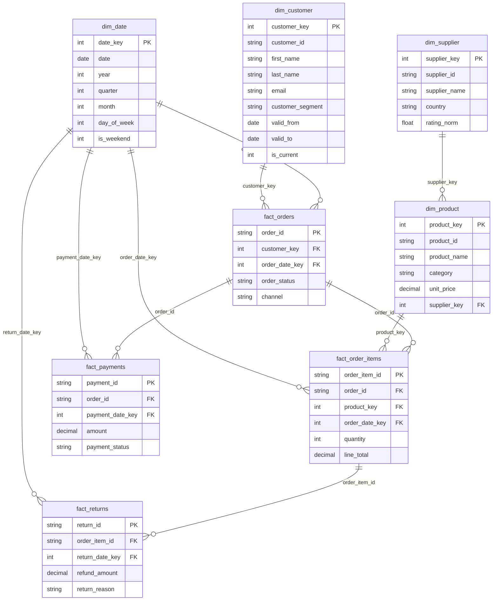
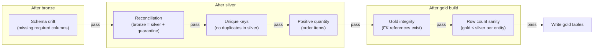
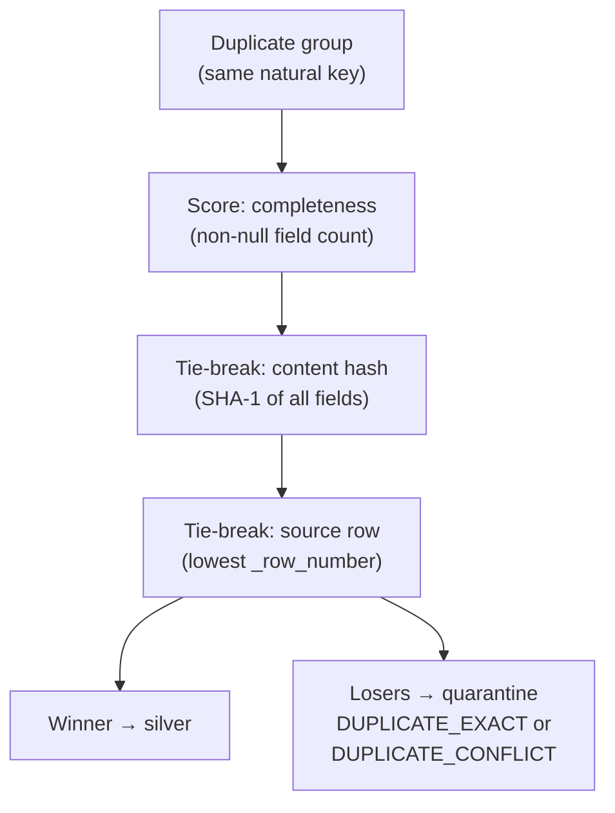
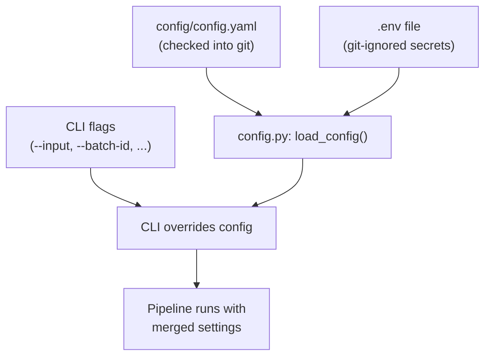

# Design

> Design patterns, principles, and key decisions behind the ShopSphere data pipeline.

---

## Design principles

| Principle | How it's applied |
|-----------|-----------------|
| **Fail fast** | Validation rejects empty data and missing columns before any transformation runs. Quality gates stop the medallion pipeline before gold is written if data is inconsistent |
| **Idempotency** | Every medallion run drops and rebuilds all tables except `pipeline_runs`. Same input → same output (excluding `_loaded_at` timestamps) |
| **Transparency** | Quarantined rows carry reason codes. Orphan foreign keys are flagged, never silently dropped. Every decision is numbered in [`DECISIONS.md`](DECISIONS.md) |
| **Config over code** | Paths, thresholds, and toggles live in [`config/config.yaml`](../config/config.yaml). CLI flags override config. Secrets stay in `.env` |
| **Minimal dependencies** | The medallion pipeline uses only Python stdlib (`csv`, `json`, `sqlite3`, `decimal`, `hashlib`) + shared config/logging. No pandas, no ORM |
| **Auditability** | `pipeline_runs`, `quality_gate_results`, and `run_params` tables record every run's outcome, gate results, and parameters |

---

## Pipeline patterns

### Generic pipeline — stage runner

- Each stage is a **plain function**: takes data, returns data
- [`Pipeline`](../src/hackathon/pipeline.py) holds an ordered list of `(name, function)` tuples
- `functools.partial` binds config values so every stage keeps the `(data) → data` signature
- Per-stage timing and error logging are built in
- Adding a stage = write a function + append it to the list in [`main.py`](../src/hackathon/main.py)

**Why not Airflow / Prefect / Dagster?** Far less to learn and deploy for a hackathon. Each stage is trivially unit-testable. Stages can be lifted into an orchestrator later without changes.

### Medallion pipeline — layered architecture

Each layer is a separate module with a single public function:
- [`bronze.read_sources()`](../src/hackathon/medallion/bronze.py) + `write_bronze()`
- [`silver.build_silver()`](../src/hackathon/medallion/silver.py) — one cleansing function per entity
- [`gold.build_gold()`](../src/hackathon/medallion/gold.py) — builds everything in memory; written to DB only after gates pass
- [`run.run_pipeline()`](../src/hackathon/medallion/run.py) — orchestrates the above with gate checks between layers

---

## Data model — Gold star schema

**Key design choices:**

| Choice | Rationale |
|--------|-----------|
| **Surrogate keys are SHA-1 hashes** of natural keys | Deterministic — same input always produces the same key, making reruns idempotent |
| **Unknown member (key = -1)** per dimension | Orphan facts (e.g. order referencing a missing customer) point to `-1` instead of NULL. Source ID is preserved in `*_id_source` |
| **SCD Type 2 on `dim_customer`** | Structure is in place (`valid_from`, `valid_to`, `is_current`) but the single snapshot means every customer has exactly one version. Ready for incremental loads |
| **`line_total` recomputed** with `Decimal ROUND_HALF_UP` | Source totals are inconsistent (often 2× or ½ the expected value). Original kept in `source_line_total`, mismatch flagged |

See [`data_model.md`](data_model.md) for full column lists and grain definitions.

---

## Quality strategy

Quality gates run between each medallion layer. A failed gate **stops the pipeline** — gold is never written from bad data.

| Gate | Layer | What it checks |
|------|-------|---------------|
| `schema_drift` | Post-bronze | Required columns present in source files |
| `reconciliation` | Post-silver | `bronze_count == silver_count + quarantine_count` per entity |
| `unique_key` | Post-silver | No duplicate primary keys in silver tables |
| `positive_quantity` | Post-silver | All order item quantities are positive |
| `gold_integrity` | Post-gold | Foreign keys in facts reference existing dimension keys |
| `gold_row_count` | Post-gold | Gold tables have ≤ rows than corresponding silver tables |

All gate results are persisted in the `quality_gate_results` table with `run_id`, `gate`, `entity`, `passed`, and `detail`.

### Quarantine

Rejected rows are **never dropped** — they go to `quarantine_<entity>` tables with:
- The raw row data as JSON
- The primary key value
- A reason code (e.g. `INVALID_DATE`, `NEGATIVE_QUANTITY`, `DUPLICATE_EXACT`, `DUPLICATE_CONFLICT`)

This ensures `bronze = silver + quarantine` always holds, making reconciliation auditable.

---

## Duplicate resolution

- **No `last_updated` column** exists in the source data, so the most complete record wins
- Content hash makes the result **independent of file order** — sorting by hash before row number ensures determinism
- Exact duplicates get `DUPLICATE_EXACT`; differing duplicates get `DUPLICATE_CONFLICT`

---

## Configuration architecture

**Precedence:** CLI flags > `config.yaml` values > built-in defaults

| Config section | Controls |
|---------------|----------|
| `paths` | Raw / interim / processed directories |
| `input` | Default input file for the generic pipeline |
| `bigquery` | SQL query, destination table, write disposition, cost guard |
| `validate` | Required columns, allow-empty toggle |
| `transform` | Drop-duplicates toggle |
| `output` | Default output CSV path |
| `medallion` | Input dir, DB path, batch ID, reference date, thresholds |

Secrets (`GCP_PROJECT_ID`, `LOG_LEVEL`) go in `.env` — loaded by `python-dotenv` before any GCP SDK call.

---

## Error handling

| Scenario | Behaviour |
|----------|-----------|
| Unsupported file type | `ingest.py` raises `ValueError` listing all supported formats |
| Empty input data | `validate.py` raises `ValueError` immediately |
| Missing required columns | `validate.py` raises with **all** missing columns at once |
| Quality gate failure | `quality.GateFailure` raised; gold not written; run logged as `FAILED` |
| BigQuery auth missing | `bigquery.py` raises `ValueError` before the SDK's cryptic error |
| Any stage exception | `Pipeline.run()` logs the full traceback, then re-raises |
| Medallion run crash | `run.py` catches all exceptions, logs `FAILED` to `pipeline_runs`, then re-raises |

---

## Extensibility

| Want to… | Do this |
|----------|---------|
| Add a generic pipeline stage | Write a `(data) → data` function, append to `build_pipeline()` in [`main.py`](../src/hackathon/main.py) |
| Add a new source file format | Add one entry to the `READERS` dict in [`ingest.py`](../src/hackathon/stages/ingest.py) |
| Add a medallion entity | Add source definition in [`bronze.py`](../src/hackathon/medallion/bronze.py) `SOURCES`, add a cleansing function in [`silver.py`](../src/hackathon/medallion/silver.py), add gold table in [`gold.py`](../src/hackathon/medallion/gold.py) |
| Switch from SQLite to Postgres | Replace [`db.py`](../src/hackathon/medallion/db.py) — it's the only module that touches the database |
| Add KPI logic | Add a calculation and output contract in `medallion/kpis.py`, then cover it with a gold-fixture test |
| Move to cloud orchestration | Each stage/module function can be lifted into Airflow/Prefect tasks as-is |
